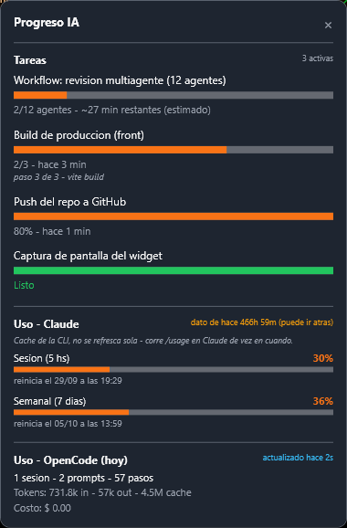
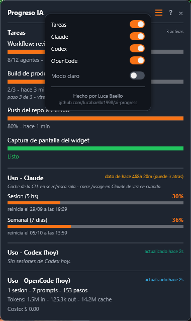
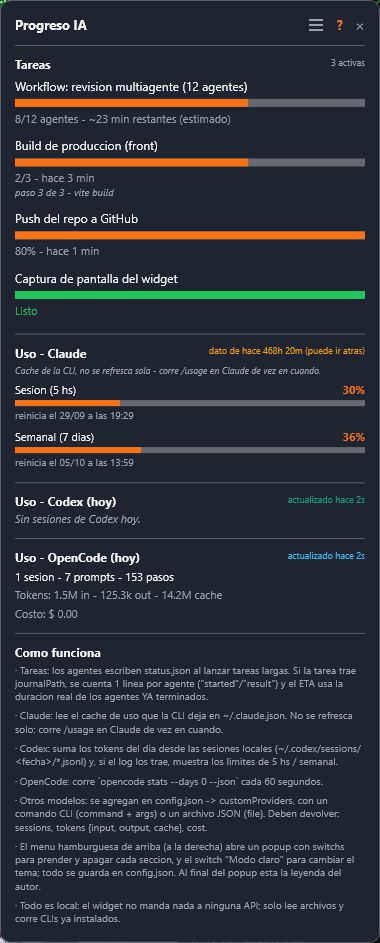
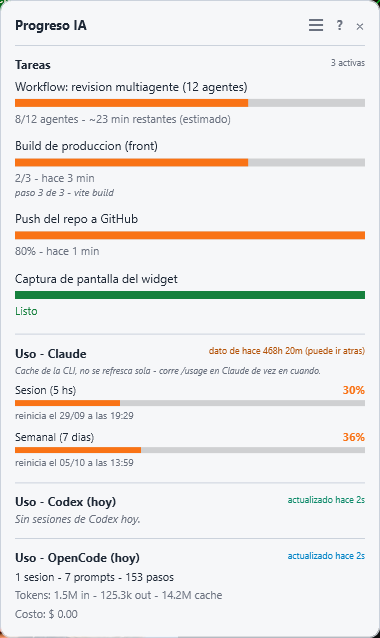

# ai-progress

Widget flotante para Windows que muestra, siempre visible arriba a la derecha:

1. **Tareas de agentes de IA** — barras de progreso reales, leyendo un `status.json` que
   mantienen los agentes (Claude Code, OpenCode o cualquier script propio).
2. **Uso de Claude** — ventana de 5 h y límite semanal de 7 días, leído del cache de la CLI
   (`~/.claude.json`), con indicador de qué tan viejo es el dato.
3. **Uso de Codex** — sesiones y tokens del día desde los logs locales
   (`~/.codex/sessions/**/rollout-*.jsonl`); si el log trae límites, también muestra las barras
   de 5 h / semanal.
4. **Uso de OpenCode** — sesiones, prompts, pasos, tokens y costo del día, vía
   `opencode stats --days 0 --json` (refresco cada 60 s).
5. **Otros modelos** — proveedores propios definidos en `config.json` (un comando CLI o un
   archivo JSON con métricas).

El **menú hamburguesa** (arriba a la derecha) abre un **popup flotante** — fondo más oscuro, no
empuja el contenido — con *switchs* para prender/apagar cada sección y el switch **Modo claro**
(tema claro/oscuro); todo se guarda en `config.json`. El botón **?** muestra la explicación de cómo
funciona dentro del propio widget, y al pie del popup está la leyenda del autor.



Popup del menú (switchs por sección + leyenda):



Con la ayuda abierta (botón **?**):



Modo claro (switch **Modo claro** del menú):



## Historia

`ai-progress` es la evolución de un proyecto personal anterior: **`claude-progress`**, un widget
mínimo que armé para mirar el uso de Claude Code (ventana de 5 h y límite semanal) mientras corría
workflows largos de agentes. Nunca fue un repo: vivió siempre en una carpeta local, como
herramienta de trabajo.

Cuando el día a día se repartió entre más herramientas — Codex, OpenCode, Claude, workflows
multiagente — ese widget se quedó corto: solo miraba a Claude y no sabía nada de las tareas en
curso. `ai-progress` es la generalización: un monitor flotante para todas las herramientas de IA,
con progreso real de tareas, uso por proveedor, menú de secciones y tema claro/oscuro.

La idea de fondo no cambió: pegarle un vistazo y saber qué está pasando, sin abrir una terminal ni
cambiar de ventana.

## Requisitos

- Windows + **PowerShell 7** (`pwsh`) — usa `ConvertFrom-Json -AsHashtable`.
- Opcional: CLI de OpenCode (`opencode` en el PATH, `%USERPROFILE%\bin\opencode.exe`, o el que
  trae OpenCode Desktop) para la sección de OpenCode. La de Codex funciona con solo tener sus
  logs locales.

## Uso

- Doble clic en `launch.vbs` (no abre consola).
- O desde consola: `pwsh -NoProfile -ExecutionPolicy Bypass -File .\ai-progress.ps1`.

Es un monitor: cerrar la ventana no cancela ninguna tarea.

## Tareas: `status.json`

El widget lee uno o varios `status.json` (por default el que está al lado del script). Formas de
progreso soportadas por tarea:

| Forma | Campos | Resultado |
|---|---|---|
| Workflow de Claude | `journalPath` + `expectedAgents` | Progreso **real** por agente (lee el `journal.jsonl`) + ETA con la duración de los agentes ya terminados |
| Contador | `total` + `done` | Barra `done/total` + tiempo transcurrido |
| Porcentaje | `progress` (0 a 1) | Barra al porcentaje |
| Sin datos de avance | (ninguno) | Barra indeterminada + tiempo transcurrido |

Campos comunes: `id`, `name`, `startedAt` (ISO), `status` (`running` \| `done` \| `error`),
`detail` (línea extra opcional).

Ejemplo completo en [`status.example.json`](status.example.json). Los agentes lo actualizan al
lanzar tareas largas; por ejemplo:

```json
{
  "tasks": [
    {
      "id": "t1",
      "name": "Build de producción",
      "total": 3,
      "done": 1,
      "startedAt": "2026-10-19T10:00:00Z",
      "status": "running",
      "detail": "vite build — paso 2 de 3"
    }
  ]
}
```

## Configuración (`config.json`)

Copiá [`config.example.json`](config.example.json) a `config.json` y editá lo que necesites.
Todo es opcional (el widget arranca con defaults sensatos). El archivo está gitignored, y el
propio widget lo reescribe cuando usás el menú hamburguesa o el botón **?**.

```json
{
  "statusPaths": ["status.json"],
  "sections": { "tasks": true, "claude": true, "codex": true, "opencode": true },
  "showHelp": false,
  "theme": "dark",
  "opencodeCliPath": null,
  "opencodeRefreshSeconds": 60,
  "codexRefreshSeconds": 60,
  "customProviders": []
}
```

### Proveedores propios (`customProviders`)

Cada proveedor agrega una sección (y su chip en el menú). Dos formas de obtener los datos:

- `command` (+ `args` opcional): se ejecuta y tiene que imprimir **JSON por stdout**.
- `file`: ruta a un JSON local (se relee en cada refresco).

JSON esperado — todos los campos son opcionales:

```json
{
  "sessions": 3,
  "prompts": 42,
  "steps": 210,
  "tokens": { "input": 320000, "output": 18000, "cache": { "read": 1500000, "write": 0 } },
  "cost": 0.42
}
```

Ejemplo de configuración (para cualquier CLI que exponga stats en JSON):

```json
{
  "customProviders": [
    { "id": "gemini", "name": "Gemini", "command": "gemini", "args": ["stats", "--json"] }
  ]
}
```

## Notas

- Solo lee archivos locales; no manda nada a ninguna API. Los únicos procesos que ejecuta son
  los CLIs configurados (OpenCode y los `customProviders`).
- El ETA de workflows es **estimado**: usa la duración real de los agentes ya terminados, no el
  tiempo total transcurrido (una pausa larga no lo infla).
- El % de Claude es un cache de la CLI: puede quedar atrás de lo que muestra el chat (se indica la
  edad del dato). Codex se recalcula cada 60 s desde los logs; si no hubo sesiones hoy, lo dice.
- Viene del widget personal para Claude Code `claude-progress`, generalizado a IA en general
  (ver **Historia**).
